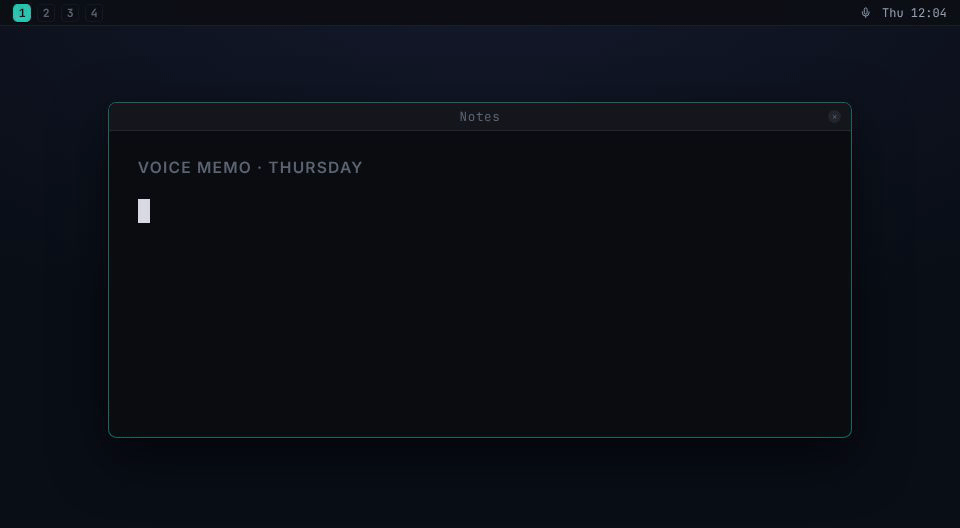

```
            _     _
 __      __| |__ (_)___  _ __ ___
 \ \ /\ / /| '_ \| / __|| '__/ __|
  \ V  V / | | | | \__ \| |  \__ \
   \_/\_/  |_| |_|_|___/|_|  |___/

  speak. type. done.
```

# whisrs

[](https://crates.io/crates/whisrs)
[](https://docs.rs/whisrs)
[](https://github.com/primaprashant/awesome-voice-typing)

**Voice for the Linux desktop: dictation, read-aloud, meeting transcription, voice-driven LLM commands and coding agents, with Groq, Deepgram, OpenAI or offline whisper.cpp.**

Speech-to-text for Wayland, X11, Hyprland, Sway, Niri, GNOME, and KDE. Press a hotkey, speak, and your words appear at the cursor, in any app. Speech recognition runs in the cloud (Groq, Deepgram, OpenAI) or fully offline through whisper.cpp.

Other hotkeys read selected text aloud, rewrite it with an LLM, or hand a task to a coding agent (Claude Code, OpenCode, Codex, GitHub Copilot) that answers out loud. Meeting transcription turns your mic and the system audio into one timestamped Markdown transcript with speaker names. One Rust daemon and a small CLI, open source under MIT.



## Features

- **Dictation**: text is typed while you talk on a streaming backend, or when you stop on a batch one, with your keyboard layout's own keys (AltGr and dead keys too). [Batch and streaming](docs/configuration.md#batch-and-streaming-backends)
- **Offline, on CPU or GPU**: whisper.cpp runs on your machine; a Vulkan, CUDA or HIP build moves it to the GPU. [GPU acceleration](docs/gpu-acceleration.md)
- **Read aloud**: select text and hear it, through Groq, Deepgram, or a local or OpenRouter speech server. [`[tts]`](docs/config-reference.md#tts)
- **Voice + LLM**: rewrite the selection with a spoken instruction, give named instructions their own hotkeys, or clean up every dictation, with any OpenAI-compatible endpoint, local ones included. [LLM commands](docs/configuration.md#llm-commands)
- **Voice + coding agents**: give Claude Code, OpenCode, Codex or GitHub Copilot a hotkey; it works in its project, answers in a short reply spoken through `[tts]`, and an optional overlay shows what it is doing. [Agent mode](docs/agents.md)
- **Meeting transcription**: record your mic and the system audio, then get a timestamped Markdown transcript with [speaker names](docs/recording.md#speaker-names), an optional [summary](docs/recording.md#summaries), and a read-only [MCP server](docs/recording.md#mcp-server) so an agent can search your recordings. [Recording](docs/recording.md)
- **Setup and config**: a full-screen setup wizard, a config editor (`whisrs config`) that an AI agent can drive too (`cargo install taria-mcp`, then `man whisrs`), and [profiles](docs/configuration.md#profiles) that switch the backend and other settings (offline, work) with one command.
- **Extras**: tray icon, on-screen overlay, [word replacements](docs/configuration.md#word-replacements), a [vocabulary file](docs/configuration.md#the-vocabulary-file), dictation history, and a failed dictation's audio kept for `whisrs transcribe-recovery`.

What changed in each release: [GitHub Releases](https://github.com/y0sif/whisrs/releases).

## Installation

### Quick install

```bash
curl -sSf https://y0sif.github.io/whisrs/install.sh | bash
```

For x86_64 and aarch64. The script installs the runtime libraries, puts the latest `whisrs` and `whisrsd` in `/usr/local/bin`, and runs `whisrs setup`. Run it again to upgrade. Pin a release with `WHISRS_VERSION`, or take the minimal build (cloud backends only, no whisper.cpp) with `WHISRS_MINIMAL=1`:

```bash
curl -sSf https://y0sif.github.io/whisrs/install.sh | WHISRS_VERSION=v0.2.1 bash
```

### Arch Linux (AUR)

```bash
yay -S whisrs-bin
```

- `whisrs-bin`: the prebuilt release, the recommended package.
- `whisrs`, `whisrs-cuda`, `whisrs-vulkan`: the tagged release compiled from source, for the CPU, CUDA or Vulkan (community-maintained).
- `whisrs-git`: builds `main` when you install it; reinstall it to update.

### Cargo

```bash
cargo install whisrs --locked
```

It compiles whisper.cpp, so it needs a C++ toolchain and a few system packages first; [CONTRIBUTING.md](CONTRIBUTING.md) lists them per distro. Add `--features vulkan` (or `cuda`, `hipblas`) for a [GPU build](docs/gpu-acceleration.md).

### Nix

```bash
nix profile install github:y0sif/whisrs
```

Or add it to your flake inputs: `inputs.whisrs.url = "github:y0sif/whisrs";`

### Prebuilt tarball

[GitHub Releases](https://github.com/y0sif/whisrs/releases/latest) has `whisrs-linux-x86_64.tar.gz` and `whisrs-linux-aarch64.tar.gz`, plus `-minimal` versions without whisper.cpp. Each holds `whisrs`, `whisrsd`, the man pages, the udev rule and the service files. Copy the two binaries onto your `PATH`.

### First run

```bash
whisrs setup
```

The wizard, which the quick install already ran, picks a backend and tests its API key, or downloads a whisper.cpp model, then checks your microphone, `/dev/uinput` access (for typing), the user service and a hotkey, fixing each with a keypress. It needs a terminal. Then press your hotkey, speak, and press it again: the text appears at your cursor. If something does not work, see [troubleshooting](docs/troubleshooting.md).

## Usage

Bind `whisrs toggle` to a key. `whisrs setup` writes the binding on Hyprland and Sway. On Sway it is `bindsym $mod+w exec whisrs toggle`; on Hyprland it looks like this:

```
# ~/.config/hypr/hyprland.conf
bind = $mainMod, W, exec, whisrs toggle
bind = $mainMod SHIFT, W, exec, whisrs toggle -l de   # a second key that dictates in German
```

On other desktops, bind it in the keyboard shortcut settings, or set `[hotkeys]` in config.toml, which whisrs reads from the keyboard itself on any desktop ([keys are physical positions](docs/troubleshooting.md#hotkey-keys-are-physical-positions-not-layout-characters)).

| Command | What it does |
|---|---|
| `whisrs toggle [-l LANG]` | Start or stop dictation; `-l` sets the language for one session (`de`, `en-US`, `auto`) |
| `whisrs cancel` | Stop and discard the audio |
| `whisrs speak` | Read the selected text aloud (alias `read`; run it again to stop); `--text "..."` speaks the given text |
| `whisrs command` | Speak an instruction, and the LLM rewrites the selected text |
| `whisrs llm-command <name>` | Dictate through a named `[[llm_commands]]` instruction |
| `whisrs agent <name>` | Record a voice turn for a coding agent; with no name, list the agents |
| `whisrs recording toggle` | Start or stop recording your mic and the system audio |
| `whisrs recording show last` | Print a transcript; also `list`, `copy`, `name`, `summarize`, `retry`, `delete` |
| `whisrs profile [NAME]` | List config profiles, or switch to one (`next`, `base`) |
| `whisrs config` | Edit the config in a full-screen editor |
| `whisrs log` | Show recent dictations |
| `whisrs transcribe-recovery` | Transcribe the audio a failed dictation saved |
| `whisrs status`, `whisrs restart` | Show the daemon's state, or restart it |
| `whisrs mcp` | Serve your recordings to an AI agent over MCP (`claude mcp add whisrs -- whisrs mcp`) |

Full reference: `whisrs <command> --help` and `man whisrs` ([contrib/whisrs.1](contrib/whisrs.1)).

## Transcription Backends

whisrs works with eight speech recognition backends, set with `[general] backend`:

| Backend | Text is typed | Runs on | Cost |
|---|---|---|---|
| `groq` (default) | When you stop | Cloud | Free tier |
| `deepgram-streaming` | While you talk | Cloud | Paid, free credit on signup |
| `deepgram` | When you stop | Cloud | Paid, free credit on signup |
| `openai-realtime` | While you talk | Cloud | Paid |
| `openai` | When you stop | Cloud | Paid |
| `openai-compatible-realtime` | While you talk | Your server (Lemonade or similar) | Free |
| `local-whisper` | While you talk, phrase by phrase | Your machine (whisper.cpp) | Free |
| `asr-sidecar` | When you stop | Your server (Parakeet, Nemotron, Moonshine and more), or OpenRouter | Free on your server; OpenRouter is paid |

For offline use, pick `local-whisper` in `whisrs setup` and it downloads a model (`base.en` to start). Local server recipes are in [contrib/asr-sidecars/](contrib/asr-sidecars/). More: [batch and streaming backends](docs/configuration.md#batch-and-streaming-backends), [ASR sidecar servers](docs/configuration.md#asr-sidecar-servers), [OpenRouter](docs/configuration.md#openrouter).

## Supported Environments

whisrs runs on Wayland and X11 desktops alike: it types through the Wayland virtual keyboard, uinput or XTEST, and hotkeys work on every desktop.

| Desktop | Status |
|---|---|
| Hyprland | Tested |
| Niri | Tested |
| X11 | Tested |
| GNOME (Wayland) | Tested, no window tracking; the overlay needs the bundled [Shell extension](docs/configuration.md#gnome-overlay) |
| Sway | Implemented |
| KDE Plasma (Wayland) | Untested, no window tracking |

Without window tracking, whisrs cannot return focus to the window you started in, or tell a terminal from other windows ([terminal detection](docs/configuration.md#terminal-detection)). Audio comes from the ALSA default input, which follows your PipeWire or PulseAudio default source through `pipewire-alsa` or `pulseaudio-alsa`, or from the source set in `[audio] device`. Reports from Sway, i3 and KDE are welcome: [open an issue](https://github.com/y0sif/whisrs/issues).

## How whisrs Compares

whisrs is a background daemon and a CLI you bind to any hotkey, not a GUI app. It types real keystrokes in your keyboard layout, so it works in terminals, editors and browsers alike, and you choose between cloud and offline speech recognition. [docs/comparison.md](docs/comparison.md) compares it feature by feature with other dictation tools.

## FAQ

**Is there a Wispr Flow or Superwhisper alternative for Linux?**
Yes: whisrs is an open-source Linux dictation tool, an alternative to Wispr Flow and Superwhisper. Press a hotkey, speak, and the text is typed at your cursor in any app, on Wayland or X11, with cloud or offline speech recognition. See [how it compares](docs/comparison.md).

**Does whisrs work offline?**
whisrs works fully offline with the `local-whisper` backend, which runs whisper.cpp on your machine: no API key, and no audio leaves it. `whisrs setup` downloads the model for you. Read-aloud and LLM commands can use local servers too.

**Does whisrs work on Wayland and GNOME?**
whisrs works on Wayland, GNOME included, and on X11. It types through the Wayland virtual keyboard or uinput on Wayland, and through uinput or XTEST on X11. On GNOME the overlay needs the bundled Shell extension. See [Supported Environments](#supported-environments).

**Which transcription backend should I pick?**
Groq is the default and the easiest start: it has a free tier and needs only an API key. For text typed while you talk, pick `deepgram-streaming` or `openai-realtime`; for no cloud at all, `local-whisper`. See [Transcription Backends](#transcription-backends).

**Can I talk to Claude Code by voice?**
whisrs gives Claude Code, OpenCode, Codex or GitHub Copilot its own hotkey through an `[[agents]]` entry. Press it, say what you want, and the agent works in its project; when the turn ends, whisrs speaks a short reply through `[tts]` (a notification while it is off). See [agent mode](docs/agents.md).

**Can whisrs transcribe meetings?**
whisrs records your microphone and the system audio with `whisrs recording`, then writes one timestamped Markdown transcript with speaker names. It records what your computer plays, so it works with any call app, and it can add an LLM summary. See [recording](docs/recording.md).

More answers: [docs/faq.md](docs/faq.md).

## Configuration

whisrs reads `~/.config/whisrs/config.toml`, which `whisrs setup` writes and `whisrs config` edits.
How the features fit together is in [docs/configuration.md](docs/configuration.md), and every key in [docs/config-reference.md](docs/config-reference.md).

## Troubleshooting

See [docs/troubleshooting.md](docs/troubleshooting.md), including [wrong characters on non-US layouts](docs/troubleshooting.md#garbled-output--wrong-characters-on-non-us-layouts) and [noisy rooms or quiet mics](docs/troubleshooting.md#noisy-room-or-quiet-mic).

## Contributing

Bug reports and pull requests are welcome. [CONTRIBUTING.md](CONTRIBUTING.md) covers building, testing and sending a change.

## License

[MIT](LICENSE)
